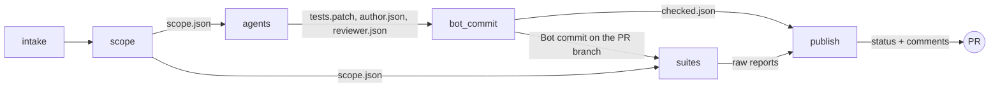

# How a PR run adds tests

For reviewers and maintainers: one PR run from push to status, showing who writes the tests, where each file goes, and which job may change the repo. Two workflows take part: `pr-intake`, which runs from the PR and only records the event, and `pr-test-engineer`, which runs from the default branch and does the work. Why it is split this way is in [ADR 0004](adr/0004-isolate-pr-code-from-secrets.md).

## The short answer

The **Author** agent writes the tests. It writes them to the runner's disk, not to GitHub. A later job with no model pushes them to the PR branch as the **Bot commit**.

There are two kinds of "write" in a PR run, and no job has both kinds together with the model key:

| Kind of write | Where it lands | Who does it |
|---|---|---|
| To the runner's disk | a temporary checkout on the GitHub runner, deleted when the job ends | the Author, test files only |
| To the repo on GitHub | the PR branch, as a commit | the `bot_commit` job, which runs no model |

---

## The jobs, in order

| Job | GitHub token | Model key | Runs PR code | Reads | Produces |
|---|---|---|---|---|---|
| `intake` | contents, actions, pull requests read | no | no | the `intake` artifact of the `pr-intake` run, the live PR | job outputs: PR number, head and base, action, label; or a stop |
| `scope` | contents, pull requests, issues, statuses read; the GitHub App's token for statuses write | no | no | the live PR, the diff | `scope.json`: changed files to test, skipped files with a reason; the pending status |
| `agents` | contents read | yes, from the Environment `test-agent` | only in Docker containers | `scope.json`, the PR description | `tests.patch`, `author.json`, `reviewer.json` |
| `bot_commit` | contents read; the App's token for contents write | no | no | the `agents` files | the Bot commit; `checked.json` |
| `suites` | contents read | no | yes, with no secrets | the final commit | the job result (fails when typecheck or a suite fails) and the raw reports: coverage, flaky check, mutation |
| `publish` | contents, pull requests read; the App's token for statuses write and pull-requests write | no | no | every file above | the `test-agent/verify` status and the three comments |

Files pass between jobs as workflow artifacts. A job never reads another job's disk. `publish` downloads the artifacts of the four jobs by name, because `suites` runs PR code that could upload any other.

---

## Step by step

0. **`pr-intake` records the event.** On a push, a label change and so on, it uploads the PR number, head SHA, action and skip label. It runs from the PR and has no secrets or token scopes, so its artifact is untrusted. Fork PRs get no `pr-intake` run.
1. **`intake` checks the event, then `scope` decides the Scope.** `intake.ts` validates the artifact and the live PR, and stops the run, with no status and no comment, unless the PR is open, from this repo and still at the analyzed head. The run starts about a minute after the push. `scope` then reads the live PR and its diff. `.github/scripts/contracts/rules.ts` sorts each changed file into a candidate or a skipped file with a reason. With no candidates, or on a draft or fork PR, the agents do not run.
2. **The Author writes tests on the runner's disk.** In `agents`, the Author follows its skills: [`scope-change`](../.claude/skills/scope-change/SKILL.md), [`extract-intent`](../.claude/skills/extract-intent/SKILL.md), [`author-tests`](../.claude/skills/author-tests/SKILL.md), [`prove-tests`](../.claude/skills/prove-tests/SKILL.md). It may write only test files: a hook (`guard.ts hook`) blocks every other path, and every shell command not listed in `AGENT_COMMANDS` in `rules.ts`. It runs the tests in a Docker container that has no access to the model key and cannot write the checkout. Before the Author and again before the Reviewer, `overlay.sh check` restores the agent config and instruction files from the overlay and warns with each file that had changed.
3. **`agents` saves the change as a patch.** Everything the Author left in the checkout becomes `tests.patch`. The Reviewer then reads the patch, read-only, following [`review-tests`](../.claude/skills/review-tests/SKILL.md), and writes `reviewer.json`. The job uploads the three files. Its token is read-only, so it cannot push.
4. **`bot_commit` checks the patch, then pushes it.** It runs the base branch's scripts, never the PR's:
   - `guard.ts patch` rejects a patch that touches any non-test path, renames into source, or adds a symlink.
   - `agent-output.ts` checks both agents' output against the schemas and the head checkout, and lists the files to drop: test files with a blocking Finding, and new files that hold a flagged Defect's failing test. It also lists the flagged Defects whose test is in no file of the patch (`missingDefectTests`); that is not an error, and a confirmed one turns the status red. Output that is untrustworthy as a whole (schema, attempts over budget, duplicate or unknown Units, a missing Reviewer, a Defect test left in an existing file) is invalid. A slip in one Unit's own content (its name is not in its file, a test name contradicts its Expectation's kind, a test is listed twice, a test file does not exist) only makes that Unit `check-rejected` (`checkRejected` in `checked.json`): its test files are dropped, as are the Units in them, and the run stays valid. A backticked name in a summary that no Unit, test or file contains is flagged in that agent's comment, not rejected.
   - `defect-proof.ts build` saves the new files that hold a flagged Defect's test (only those that contain the named test) as `defects.patch`, with `defects.json` naming each Defect's test and the Author's expected and received values, as the artifact `defects`. The Bot commit does not get them.
   - It applies the rest and commits it as the GitHub App (`<slug>[bot]`). The push is a plain push to the head the run analyzed. If the author pushed in the meantime, the push is rejected and the newer run takes over.
5. **`suites` runs the suites on the final commit.** That is the Bot commit, or the PR head if there was none. It has no secrets, so PR code can run here on the host. It fails when a typecheck or suite fails, and it runs no trusted step after PR code. It also applies `defects.patch` to a copy of the final tree and runs only those test files, with no network where the runner allows it. That run is expected to fail and does not change the job result.
6. **`publish` posts the result.** It downloads each artifact only if the job that makes it succeeded, turns the raw reports into `results.json` with a script that keeps only numbers and known labels (it also counts the changed lines the final suite ran, from the hunks in `scope.json` and the lcov line hits), decides which Defects are proven (`defect-proof.ts decide`: the test failed with an assertion that shows the Author's values), and decides `test-agent/verify` and writes the Report, Test author and Test reviewer comments. The Report also keeps the earlier runs: `report.ts` reads the old Report comment, validates the history marker at its end, and adds the previous run's line.

---

## What keeps a bad patch out

| Risk | What stops it | Where |
|---|---|---|
| The Author edits source code | the write hook blocks the edit, and a shell write; `guard.ts patch` rejects the patch | `agents`, `bot_commit` |
| The PR description steers the Author into pushing something | the Author has no write token and no `gh` or `git push` | `agents` |
| A PR edits the workflow to read the key or post a status | `pr-test-engineer` runs from the default branch; the key is in the Environment `test-agent`, limited to `main`; `intake.ts` checks the PR's artifact against the live PR | `intake`, `agents` |
| PR code reads the model key | PR code runs only in a container without the key, or in `suites`, which has no secrets | `agents`, `suites` |
| A failing test reaches the branch | `prove-tests` moves it to its own file; `agent-output.ts` drops that file | `agents`, `bot_commit` |
| A wrong test reaches the branch | a blocking Finding from the Reviewer drops its file | `bot_commit` |
| The bot overwrites a newer push | the push targets the analyzed head only, without force | `bot_commit` |

---

## Related

- Why the jobs are split by privilege: [ADR 0004](adr/0004-isolate-pr-code-from-secrets.md).
- Why the agents write only tests: [ADR 0002](adr/0002-test-changed-units-and-write-only-tests.md).
- How Defects and Findings are decided: [ADR 0003](adr/0003-derive-expectations-from-intent-and-review-defects.md).
- How the status gates the merge: [ADR 0005](adr/0005-gate-merges-on-test-agent-verify.md).
- The workflows: [`.github/workflows/pr-intake.yml`](../.github/workflows/pr-intake.yml) and [`.github/workflows/pr-test-engineer.yml`](../.github/workflows/pr-test-engineer.yml).
