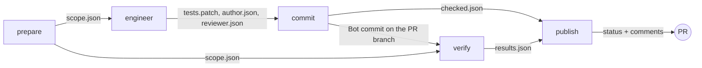

# How a PR run adds tests

For reviewers and maintainers: one PR run from push to status, showing who writes the tests, where each file goes, and which job may change the repo. Why it is split this way is in [ADR 0004](adr/0004-isolate-pr-code-from-secrets.md).

## The short answer

The **Author** agent writes the tests. It writes them to the runner's disk, not to GitHub. A later job with no model pushes them to the PR branch as the **Bot commit**.

There are two kinds of "write" in a PR run, and no job has both kinds together with the model key:

| Kind of write | Where it lands | Who does it |
|---|---|---|
| To the runner's disk | a temporary checkout on the GitHub runner, deleted when the job ends | the Author, test files only |
| To the repo on GitHub | the PR branch, as a commit | the `commit` job, which runs no model |

---

## The jobs, in order

| Job | GitHub token | Model key | Runs PR code | Reads | Produces |
|---|---|---|---|---|---|
| `prepare` | contents, pull requests, issues read; statuses write | no | no | the live PR, the diff | `scope.json`: changed files to test, skipped files with a reason; the pending status |
| `engineer` | contents read | yes | only in Docker containers | `scope.json`, the PR description | `tests.patch`, `author.json`, `reviewer.json` |
| `commit` | contents write | no | no | the `engineer` files | the Bot commit; `checked.json` |
| `verify` | contents read | no | yes, with no secrets | the final commit | `results.json`: typecheck, suites, coverage, mutation |
| `publish` | statuses write, pull-requests write | no | no | every file above | the `test-agent/verify` status and the three comments |

Files pass between jobs as workflow artifacts. A job never reads another job's disk.

---

## Step by step

1. **`prepare` decides the Scope.** It reads the live PR and its diff. `.github/scripts/contracts/rules.ts` sorts each changed file into a candidate or a skipped file with a reason. With no candidates, or on a draft or fork PR, the agents do not run.
2. **The Author writes tests on the runner's disk.** In `engineer`, the Author follows its skills: [`scope-change`](../.claude/skills/scope-change/SKILL.md), [`extract-intent`](../.claude/skills/extract-intent/SKILL.md), [`author-tests`](../.claude/skills/author-tests/SKILL.md), [`prove-tests`](../.claude/skills/prove-tests/SKILL.md). It may write only test files: a hook (`guard.ts hook`) blocks every other path. It runs the tests in a Docker container that has no access to the model key.
3. **`engineer` saves the change as a patch.** Everything the Author left in the checkout becomes `tests.patch`. The Reviewer then reads the patch, read-only, following [`review-tests`](../.claude/skills/review-tests/SKILL.md), and writes `reviewer.json`. The job uploads the three files. Its token is read-only, so it cannot push.
4. **`commit` checks the patch, then pushes it.** It runs the base branch's scripts, never the PR's:
   - `guard.ts patch` rejects a patch that touches any non-test path, renames into source, or adds a symlink.
   - `agent-output.ts` checks both agents' output against the schemas and lists the files to drop: test files with a blocking Finding, and new files that hold a flagged Defect's failing test.
   - It applies the rest and commits it as `github-actions[bot]`. The push is a plain push to the head the run analyzed. If the author pushed in the meantime, the push is rejected and the newer run takes over.
5. **`verify` runs the suites on the final commit.** That is the Bot commit, or the PR head if there was none. It has no secrets, so PR code can run here on the host.
6. **`publish` posts the result.** It decides `test-agent/verify` and writes the Report, Test author and Test reviewer comments.

---

## What keeps a bad patch out

| Risk | What stops it | Where |
|---|---|---|
| The Author edits source code | the write hook blocks the edit; `guard.ts patch` rejects the patch | `engineer`, `commit` |
| The PR description steers the Author into pushing something | the Author has no write token and no `gh` or `git push` | `engineer` |
| PR code reads the model key | PR code runs only in a container without the key, or in `verify`, which has no secrets | `engineer`, `verify` |
| A failing test reaches the branch | `prove-tests` moves it to its own file; `agent-output.ts` drops that file | `engineer`, `commit` |
| A wrong test reaches the branch | a blocking Finding from the Reviewer drops its file | `commit` |
| The bot overwrites a newer push | the push targets the analyzed head only, without force | `commit` |

---

## Related

- Why the jobs are split by privilege: [ADR 0004](adr/0004-isolate-pr-code-from-secrets.md).
- Why the agents write only tests: [ADR 0002](adr/0002-test-changed-units-and-write-only-tests.md).
- How Defects and Findings are decided: [ADR 0003](adr/0003-derive-expectations-from-intent-and-review-defects.md).
- How the status gates the merge: [ADR 0005](adr/0005-gate-merges-on-test-agent-verify.md).
- The workflow itself: [`.github/workflows/pr-test-engineer.yml`](../.github/workflows/pr-test-engineer.yml).
